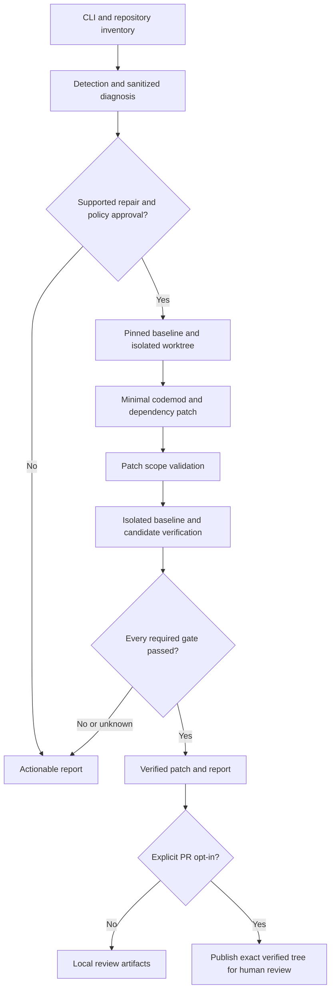

# apiheal 2.0 implementation plan

Prepared: October 31, 2026. Status: proposed work; no implementation or repair results are claimed.

Build one reproducible path from a supported integration failure to a minimal, tested pull request. Ship offline Gemini diagnosis alongside it. Expand automation only after the first path produces inspectable evidence.

## 1. Starting point and scope decisions

The workspace contains an initialized Git repository with no commits or project files. The prototype described in the supplied specification is not available here. Treat implementation as greenfield; if that prototype becomes available, assess reusable parts against the same acceptance gates before incorporating them.

| Decision | Initial implementation | Later expansion |
| --- | --- | --- |
| Runtime | Python 3.11+, Typer, Pydantic, LibCST, pytest | Broader tested runtime matrix |
| Product surface | CLI with JSON and readable reports | Hosted service and dashboard |
| First repair | Synchronous, non-streaming OpenAI legacy chat completion call, including supported response access | Embeddings, legacy text completions, Gemini, async/streaming |
| Dependency layout | One root `requirements.txt`, simple package/version declarations | `pyproject.toml`, includes, constraints, supported lock formats |
| Analysis | LibCST import/scope metadata; AST where useful for discovery | Common wrappers and cross-module data flow |
| Generation | Deterministic codemod | Opt-in, constrained LLM patch generation |
| Verification | Reviewed demo repository in an ephemeral container; offline SDK contract tests | Hardened ephemeral runner for external repositories; opt-in live checks |
| Authentication diagnosis | Offline, sanitized, evidence-based Gemini classification | Explicitly consented, read-only credentialed checks |
| Publishing | Explicit `--pr`, GitHub CLI adapter, human merge review | GitHub App installation flow |

An unspecified or unsupported pattern yields a finding with a reason. It does not trigger a speculative transformation. No dashboard, database, model-retirement substitutions, cloud permission changes, or automatic merges enter the first milestone.

The first migration preserves Chat Completions behavior using the client SDK interface documented in the [official OpenAI Python reference](https://developers.openai.com/api/reference/python). Migrating an application to the Responses API is a separate rule and is outside this first transformation.

## 2. Architecture and execution contract



Implement typed records before adding integrations:

| Record | Required information |
| --- | --- |
| `RepositorySnapshot` | Resolved root, remote identity, base commit, manifest hashes, Python constraints, clean/dirty status |
| `Finding` | Rule ID/version, provider, category, file/span, SDK evidence, severity, confidence, repairability, source provenance |
| `Diagnosis` | Endpoint family, authentication context, observed error, ranked causes, missing evidence, manual steps |
| `RepairPlan` | Finding IDs, supported preconditions, allowed paths, migration target, proposed edits, required checks |
| `PatchArtifact` | Base commit, diff/tree digest, changed paths and line counts, dependency changes |
| `CheckResult` | Gate ID, required flag, argument vector/category, environment identity, duration, exit code, outcome, sanitized log reference, test count |
| `RunResult` | Schema version, run ID, timestamps, stage/outcome, artifact references, failure reason, publication status |

Keep stage and outcome separate. Stages advance through inventory, detection, planning, patching, verification, and publication. Outcomes include `no_findings`, `unsupported`, `manual_action_required`, `policy_blocked`, `verification_failed`, `verification_indeterminate`, `verified`, and `pr_opened`.

Persist reports outside the target checkout in a configurable apiheal data directory. Store `run.json`, `findings.json`, `diagnosis.json`, `repair-plan.json`, `patch.diff`, `verification.json`, sanitized logs, and `report.md`. Version their schemas. Write stage results atomically so interruptions remain diagnosable.

Use a `src` package layout with tests outside the installed package:

```text
pyproject.toml
src/apiheal/
  cli.py
  core/{models,policy,orchestrator,worktree,run_store}.py
  detection/{inventory,python_cst}.py
  detection/rules/{openai,gemini}.py
  diagnosis/{classifier,gemini_auth,provider_errors}.py
  repair/{codemods,dependency_edit,patch_validator}.py
  verification/{runner,container,contract_tests,report}.py
  integrations/github.py
  telemetry/{redaction,metrics}.py
tests/{unit,integration,fixtures}/
examples/{legacy-openai,legacy-gemini,gemini-auth-incident}/
rules/                         # Versioned migration specifications
runner/                        # Container image and trusted check definitions
.github/workflows/apiheal-check.yml
```

The brace notation groups proposed files/directories; these are not existing files. Add `repair/llm_patch.py` and prompts only in C01. Add example repositories and workflow support when their respective milestones are ready.

## 3. Ordered implementation backlog

Effort estimates are focused engineering days for one engineer, including relevant tests. They are planning ranges, not delivery promises. Some tasks share setup, so use the milestone totals below rather than summing every range mechanically.

| ID | Work | Depends on | Acceptance evidence | Estimate |
| --- | --- | --- | --- | --- |
| A01 | Package, console entry point, development checks, fixture layout | None | Editable install exposes CLI; help and JSON error behavior work | 0.5 day |
| A02 | Typed records, run storage, redaction, policy defaults | A01 | Stable JSON schemas; representative credentials redacted before storage | 0.5–1 day |
| A03 | Inventory and committed baseline/worktree lifecycle | A02 | Dirty checkout is preserved; clean baseline pinned; cleanup cannot remove caller files | 0.5–1 day |
| A04 | Container verification runner and check manifest | A02, A03 | Positive, timeout, nonzero exit, unavailable sandbox, and zero-test cases distinguished | 1–2 days |
| A05 | First OpenAI detector and codemod with dependency edit | A02, A03 | Supported calls migrate; shadowed names and unsafe patterns remain unchanged; second pass is empty | 1–2 days |
| A06 | Orchestrate repair, scope gate, and before/after contract verification | A04, A05 | Old code fails for the expected SDK reason; candidate passes meaningful tests; failed gates prevent publishing | 0.5–1 day |
| A07 | Offline Gemini diagnostic classifier | A02 | Sanitized cases yield supported causes or uncertainty; no automatic credential/IAM changes | 0.5–1 day |
| A08 | PR preparation, exact-tree publishing, retry handling | A06 | Test repository gets one reviewable PR; failed checks and repeated publish requests cannot create unsafe/duplicate PRs | 0.5–1 day |
| A09 | Reproducible demo, documentation, evidence bundle | A07, A08 | Another developer can reproduce both the repair and manual-action diagnosis | 0.5–1 day |
| B01 | Alias coverage, wrapper discovery, full detection fixture matrix | A09 | Scope and false-positive cases documented and tested | 2–3 days |
| B02 | Embeddings, text-completion, and Gemini migration rules | B01 | Each rule has versioned provider evidence and independent request/response contract fixtures | 3–5 days |
| B03 | Structured manifests and selected lock-file support | A06 | Only supported dependency entries change; package manager regenerates lock; resolution is verified | 2–3 days |
| B04 | Hardened external-repository runner, credentialed opt-ins | A04, A09 | Isolation and hostile-repository cases pass; target credentials and publishing credentials remain separated | 2–4 days |
| B05 | GitHub Actions, release packaging, pilot repositories | B01–B04 | Installable release; manual/scheduled scans; inspectable outcomes from 3–5 repositories | 2–3 days |
| C01 | Optional LLM patch adapter | B01, B04 | Scoped structured patches pass the identical validator and verification gates; bounded retries and cost | 2–4 days |
| C02 | GitHub App and monitoring event pipeline | B05 | Least-privilege install, authenticated/deduplicated events, auditable repair runs | Separate product milestone |

Critical engineering path: `A01 → A02 → A03 → A04/A05 → A06 → A08 → A09`. A07 can proceed after A02. Develop verification and migration fixtures before adding more repair rules.

## 4. First migration implementation

### Detection and preconditions

1. Inventory files without importing or executing repository code. Exclude virtual environments, generated files, vendor directories, credential files, and paths resolving outside the repository. Bound file size and traversal.
2. Resolve direct and aliased `openai` imports using scope metadata. Match actual call expressions, not strings or comments. Reject shadowed names and ambiguous reassignment.
3. Recognize the first supported case: a synchronous `ChatCompletion.create` call with supported arguments and a traceable response consumer. Detect other legacy patterns, but mark them unsupported until their own codemods ship.
4. Require supported credentials/client configuration and a known dependency layout. Flag custom endpoints, Azure configuration, streaming, async, dynamic keyword expansion, cross-function response escape, and complex wrappers for review.
5. Store a versioned rule specification with documentation URL, retrieval date, supported source/target SDK versions, supported parameters, and fixture IDs. Resolve exact SDK pins during implementation and record them; do not select an unverified future version in this plan.

### Patch construction

Generate collision-safe imports/client variables, replace the supported call, and update response dictionary access to the target SDK's supported object access where necessary. Preserve model identifiers, messages, user configuration, comments, and unrelated formatting. Reject transformations that would change resource lifecycle or configuration semantics without a supported rule.

Edit only the relevant OpenAI requirement while preserving unrelated packages and comments. Unsupported includes, editable dependencies, VCS URLs, lock files, or conflicting constraints block automatic repair until their layout is supported.

Use one repair plan per initial run. Suggested initial bounds: at most five changed files and 200 added-plus-deleted lines, including dependency edits. Exceeding either bound produces a review-required report. Required contract tests come from apiheal's trusted harness; do not let the candidate patch remove or weaken tests to pass.

### Proof of behavior

Run the original source with its pinned original SDK to establish intended behavior. Run the same original source with the target SDK to reproduce the expected migration failure. Then run the candidate with that same target SDK and the same trusted contract cases. Assert request parameters, extracted response text, and relevant failure propagation, using the actual SDK with a controlled HTTP transport or local fixture server inside the sandbox.

Record all three environments. A generic test failure, an unavailable import, or a mock that bypasses the SDK does not prove a migration repaired behavior. Offline contract success must be labeled as offline verification; live provider availability remains untested unless separately demonstrated.

## 5. Repository isolation and verification policy

A Git worktree protects the user's checkout from edits; the execution sandbox provides the security boundary. Treat dependency installation, Python imports, test discovery, test plugins, and project build hooks as execution of repository-controlled code.

For P0, support a reviewed, pinned demo repository in an ephemeral Linux container. Require a clean committed baseline for repair; scan may report a dirty checkout, but repair must stop with actionable guidance rather than stash or discard user changes. An empty repository cannot be repaired until a baseline commit exists.

Use trusted Git invocation with hooks and untrusted repository configuration disabled where relevant. Keep Git administration and publishing on the trusted side. Copy the pinned source snapshot into the runner without the caller's `.git`, home directory, SSH agent, cloud configuration, or Docker socket.

Runner requirements:

- Non-root process, no privileged mode, dropped capabilities, resource/process/time/output limits, read-only root filesystem, and a disposable writable workspace.
- Explicit environment allowlist; no inherited provider, GitHub, repair-model, or production credentials.
- Network disabled during ordinary checks. Prepare approved, pinned wheels through a separate restricted acquisition stage; install and execute them inside the sandbox. Unsupported source builds or unavailable wheels fail closed initially.
- Trusted check definitions and argument arrays, without shell interpolation or automatic execution of arbitrary repository-provided commands. Repository configuration cannot lower apiheal's required gates or enable network access.
- Bounded cleanup of only recorded apiheal-created paths. Preserve sanitized failure artifacts independently of worktree disposal.
- No fallback to running target code on the developer host if the sandbox is missing.

Before external pilots, run untrusted repositories on dedicated hardened ephemeral infrastructure. Do not advertise the P0 local container as sufficient isolation for arbitrary hostile repositories.

| Gate | Passing condition | Blocking conditions |
| --- | --- | --- |
| Baseline and patch | Patch applies to recorded commit and allowed paths; no traversal/symlink escape | Baseline drift, forbidden paths, oversized/unexpected diff |
| Dependencies | Declared supported constraints resolve; recorded target SDK is installed | Resolver error, unsupported layout, unknown environment |
| Syntax and imports | Changed modules compile and required imports succeed in sandbox | Error, timeout, omitted required module |
| Lint/types | Configured required checks pass or satisfy an explicit documented baseline-equivalence policy | New failures; indeterminate comparison |
| Unit and contract | Relevant tests execute and required cases pass | Empty command, zero relevant tests, collection errors, skipped required cases |
| Live integration | Passes only when enabled with explicit scoped consent | Required live check fails, cannot run, or is skipped |
| Final integrity | Published candidate matches verified tree; secrets scan and final scope check pass | Mutated tests/source, suspicious artifacts, failed required check |

Each check has `passed`, `failed`, `skipped`, or `indeterminate`; required checks must pass. Optional live checks may be skipped with an explicit label. An approved alternative contract check may replace a missing repository test suite, and must assert actual behavior rather than only syntax. P0 should use a demo with both meaningful unit and SDK contract cases.

Bound the evidence to the base commit, candidate tree/diff digest, rule version, policy digest, sandbox image, dependency resolution, and trusted test-harness version. Recheck the candidate before publishing; any mutation invalidates verification. Report unrelated baseline failures separately without hiding them.

## 6. Gemini diagnosis implementation

Collect endpoint family, SDK/version, sanitized exception/status/details, authentication context, and explicitly supplied nonsecret project/region configuration. Distinguish AI Studio/Gemini Developer API from Vertex AI. Do not infer the endpoint solely from the presence of a Google Cloud project.

Use deterministic classification rules first. Categories should cover authentication, permissions, API enablement, project mismatch, billing, quota/rate limit, model/region availability, SDK incompatibility, network/service failure, and unknown. The diagnostic report includes observed evidence, plausible alternatives, confidence, missing evidence, and conditional manual steps. A status code alone is insufficient to establish the root cause.

Keep the authentication taxonomy extensible: Google's current documentation distinguishes standard API keys and authorization keys bound to service accounts. Avoid treating API keys and service-account identity as mutually exclusive categories. Preserve this distinction in diagnostic fixtures and source provenance. [Google API key documentation](https://ai.google.dev/gemini-api/docs/api-key)

Add fixtures for invalid/missing keys, restricted or blocked keys, permission denial, disabled APIs, wrong project, billing restrictions, 429 responses, unavailable models, timeouts, and ambiguous errors. Model-list success must not be treated as proof that inference is authorized. [Google troubleshooting guide](https://ai.google.dev/gemini-api/docs/troubleshooting)

The default diagnosis is offline. A later `--allow-network-diagnostics` option requires explicit consent and a narrowly scoped allowlist. It must never grant IAM roles, enable billing, rotate keys, or migrate the application to Vertex automatically. Without the founder's original sanitized error, label the demo as a representative incident rather than a diagnosis of the historical event.

For B02, build a separate Gemini codemod against pinned fixtures. Google's recommended Python package is `google-genai`; validate configuration, request, response, and error semantics rather than merely swapping imports. [Google SDK documentation](https://ai.google.dev/gemini-api/docs/libraries)

## 7. CLI, configuration, and publishing

Implement these interfaces in order:

```text
apiheal scan ./repo --format json
apiheal diagnose ./repo --log ./error.log --format json
apiheal repair ./repo --rule openai-legacy-completions --dry-run
apiheal repair ./repo --rule openai-legacy-completions --verify
apiheal repair ./repo --rule openai-legacy-completions --verify --pr
apiheal report --run-id <id>
```

`scan` and offline diagnosis do not execute target code. `--dry-run` emits a planned diff without modifying the target checkout, installing target dependencies, or publishing; transient internal planning artifacts are allowed. Repair uses an isolated worktree. Reject `--pr` without verification; verification failure cannot be overridden through a force-publish flag. No subcommand defaults to publishing.

Use a versioned configuration schema for enabled rules, supported dependency layout, file/line limits, time budgets, required checks, and artifact retention. Security-sensitive policy comes from the operator/trusted configuration, with repository values allowed only to narrow permissions. Reject unknown security settings rather than silently ignoring them.

Document command-specific exit behavior: `0` completed with no blocking finding or successful requested operation; `1` findings/manual action/unsupported work require attention; `2` invalid input/configuration; `3` policy blocked; `4` verification failed or indeterminate; `5` infrastructure/provider/publication failure. Preserve precise outcomes in JSON and provide useful stderr without corrupting stdout JSON.

The publisher operates outside the target runner and receives only verified artifacts. Use narrowly scoped GitHub credentials. Prepare the complete PR body locally first: root cause, minimal before/after diff, upstream evidence, verification matrix, environment versions, run ID, limitations, and human-review notice.

Use a collision-safe branch such as `apiheal/<rule>/<run-id>`. Compute an idempotency key from repository identity, base commit, rule version, and patch digest; persist it and reconcile existing branches/PRs after interrupted requests. Never overwrite an unrelated branch or open a second PR on an ambiguous retry. Report publication failure separately from successful local verification. If the target base moves before publication, replan/reverify against the new base before opening a PR.

## 8. Test and security backlog

| Area | Required cases |
| --- | --- |
| Detection | Direct/aliased/from imports, multiline calls, local shadowing, clean repositories, strings/comments, unsupported wrappers |
| Codemods | Minimal diff, collision-safe names, response handling, configuration preservation, comments, idempotency, unsupported parameters |
| Dependencies | Existing bounds, comments, duplicates/conflicts, unsupported includes/locks, failed resolution |
| Diagnosis | Credential/permission/billing/quota cases, endpoint ambiguity, missing evidence, transient failures |
| Runner | Nonzero exit, timeout, process/output limits, zero tests, skipped tests, missing sandbox, attempted network access |
| Security | Secret sentinels in logs/source, prompt injection, shell metacharacters, malicious paths/symlinks, forbidden file edits, test tampering |
| Lifecycle | Dirty checkout, missing commit, concurrent runs, cancellation, cleanup failure, resume after interruption |
| Publishing | Failed gate produces zero publishing calls, exact verified tree, stale base, duplicate retries, branch conflict, API failure |
| End to end | Supported repair succeeds; unsupported/manual-only case stops; broken candidate stops; second repair run makes no changes |

Redact before disk persistence, model prompts, console output, and PR construction. Prefer structured allowlisted excerpts over copying raw logs. Redaction tests use synthetic secrets and check every output sink. Store no raw credential-bearing logs by default. Keep external telemetry disabled initially; local metrics need no code or credential contents.

When C01 adds an LLM, send only approved affected spans and pinned migration instructions after redaction. Repository text remains untrusted input. The model receives no shell/Git/cloud tools and no permission to select extra paths or weaken gates. Validate structured patches, forbid test weakening and protected-file changes, bound retries/cost, and treat model unavailability as an explicit outcome. Keep backend/model ID configurable and verify availability before any live demo.

## 9. Milestones and delivery schedule

| Milestone | Expected effort | Exit criteria |
| --- | --- | --- |
| P0: reproducible prototype | Approximately 5–8 focused engineering days | A01–A09; one verified migration PR; accurate manual-action diagnosis; demonstrated failure stop |
| P1: hardened MVP | Another 2–4 engineering weeks, plus pilot scheduling | B01–B05; broader documented support; external runner; 3–5 pilot repositories |
| P2: early product | Plan after pilot feedback; provisional 4–8+ weeks | Prioritized C01/C02 work, permissions, event evidence, team reporting |

These estimates assume access to a supported container runner, a GitHub test repository, and a reproducible demo fixture. Live credentials are optional for the offline proof. Customer interview and external testing lead times are separate from engineering estimates.

The source specification's October 31–November 2, 2026 window is a stretch demonstration target, not a credible commitment to the entire MVP from this empty repository. Treat the application deadline as supplied context; its official date/time has not been independently verified here.

If pursuing that stretch target:

| Date, India time | Focus | Evidence checkpoint |
| --- | --- | --- |
| October 31 | Scaffold, records/redaction, pinned fixture, worktree and sandbox feasibility | Reproduce the expected legacy failure in isolation |
| November 1 | One codemod, dependency edit, meaningful contract tests, report | Minimal patch with before/after results; required failure path stops |
| November 2 | Offline diagnosis, publisher only if gates pass, README and recordings | Inspectable PR if ready; otherwise report the verified subset and unfinished work honestly |

If time runs short, defer LLM generation, additional providers/rules, live checks, lock formats, and scheduled monitoring. Keep isolation, truthful test reporting, redaction, and PR gating as release requirements. A local verified patch can be demonstrated while publishing remains unfinished, but it does not satisfy the full P0 definition of done.

Run customer discovery alongside development: aim for at least three documented candid discussions for the initial demo, five preferred, then 2–3 developers actually trying the tool. Record concrete breakages, dependency layouts, expected permissions, and feedback that changes priorities. Outreach and application/video submission remain separate human activities.

## 10. Evidence and completion checklist

Maintain a local outcome ledger with denominators: attempted runs, findings, generated patches, verified patches, PRs opened, PRs merged, manual-action cases, failures, and reported regressions. Record rule/version and repository commit for each result. Report only observed results; the initial targets are 3–5 repositories, 5–10 scenarios, and at least three reproducible verified repairs during hardening.

P0 is complete only when:

- [ ] A fresh installation can follow the README and reproduce one supported SDK migration.
- [ ] Baseline SDK behavior, expected target-SDK failure, and candidate success are recorded with environment versions.
- [ ] Caller checkout is preserved, diff is minimal, and repeat repair is a no-op.
- [ ] Meaningful unit/contract checks execute; a deliberately failing required gate prevents all publishing.
- [ ] A GitHub PR contains the exact verified code and sanitized evidence and requires human merge review.
- [ ] Gemini diagnosis accurately produces a code-repair candidate or manual-action report, with uncertainty retained.
- [ ] Synthetic secret tests pass across all artifact/prompt/log/PR sinks and no production secrets are used in the demo.
- [ ] README states supported and unsupported patterns, isolation requirements, exit codes, and offline/live evidence boundaries.
- [ ] Product demo, founder video, and developer-discussion evidence are tracked separately from implemented functionality.

First implementation unit: A01–A03 plus the pinned legacy fixture. Its reviewable output is an installable CLI that produces typed scan/run artifacts and creates/discards an isolated baseline without changing the caller's files. Next, establish the runner and expected failure before writing the first repair.
